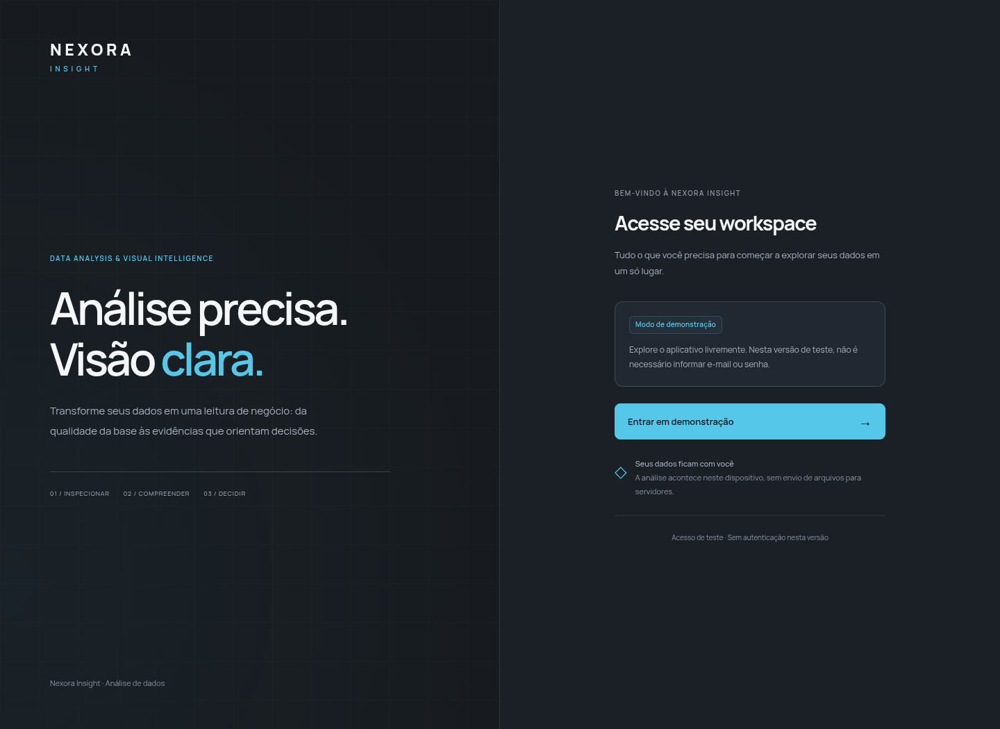

# DataAnalysis-byNexora

## Nexora Insight

O aplicativo enviado está em `diagnostico-de-dados-desktop/`.

```sh
cd diagnostico-de-dados-desktop
npm ci
npm start
```

A tela inicial permite **Entrar em demonstração**, sem credenciais. Consulte `diagnostico-de-dados-desktop/LEIA-ME.md` para uso, testes e distribuição.

## Download e visualização

[Baixar projeto ZIP](downloads/nexora-insight.zip) — abra o arquivo no GitHub e clique em **Download raw**. Extraia o ZIP e abra `app/index.html` para testar a interface.

### Tela de entrada


