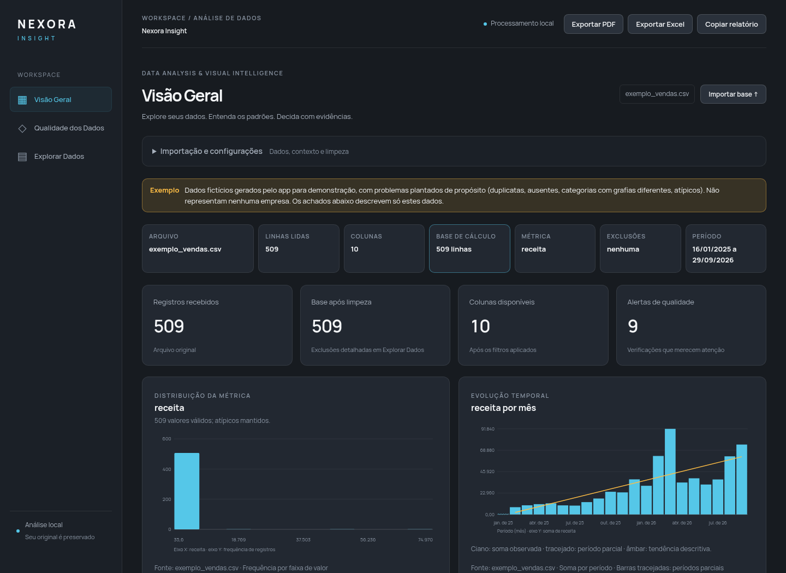

# Nexora Insight

Análise local de planilhas com diagnóstico de qualidade, correções por confirmação, histórico, gráficos e relatórios PDF/Excel.

## Executar

```sh
cd diagnostico-de-dados-desktop
npm ci
npm start
```

Acesso direto, sem login. O original é preservado; duplicatas e atípicos não são excluídos automaticamente. Leia o [guia de uso, limites e testes](diagnostico-de-dados-desktop/LEIA-ME.md).

## Download

[Baixar projeto ZIP](downloads/nexora-insight.zip) — abra o arquivo e clique em **Download raw**. O ZIP inclui os recursos locais de fonte e Excel. Para a análise, execute `npm ci && npm start` ou sirva `app/` por um servidor local, conforme o guia.

## Visão Geral



O exemplo exibido é sintético e não representa uma empresa.

[Relatório PDF de exemplo](docs/relatorio-exemplo.pdf) · [Alterações, testes e limitações](docs/VALIDACAO.md)
